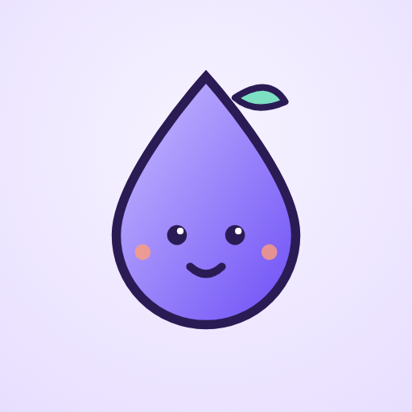

<p align="center">
  
</p>

<h1 align="center">bioOasis</h1>

<p align="center">
  <strong>Will it survive the tank?</strong><br>
  Check a biological spray <em>before</em> it goes in, not after it fails.
</p>

<p align="center">
  <a href="CHANGELOG.md"></a>
  <a href="LICENSE"></a>
  <a href="backend/requirements.txt"></a>
  
</p>

<p align="center">
  <a href="https://viabil-ag.vercel.app"><strong>Live website</strong></a> &middot;
  <a href="https://drive.google.com/file/d/1p9S7WU6k6mRM0zmPPBNIuocwJDb5wJwh/view">Android app (APK)</a> &middot;
  <a href="ARCHITECTURE.md">Architecture</a> &middot;
  <a href="docs/development.md">Develop</a> &middot;
  <a href="docs/deployment.md">Deploy</a>
</p>

---

A **biological spray** is a crop treatment made of living organisms, such as Bt, Trichoderma, Pseudomonas or Beauveria. Those organisms can die in the tank: mixed with the wrong product, in harsh water, or under strong sun. When they die, the farmer pays for a spray that does nothing.

bioOasis is a phone check a farmer runs **before** spraying. Every answer cites its source, and when the evidence is missing the app says so instead of guessing.

## What it does

**1. Read one label.** Photograph a product label. The app reads the text (OCR), works out what type of product it is, and shows what real labels and published research say about keeping that type alive. Every line carries its source.

**2. Check a mix.** Scan a second label. bioOasis answers one question - is there real evidence about using these two products together? - with one of three honest outcomes: a **documented conflict**, **limited evidence**, or **"we cannot confirm this combination"**. You get a takeaway slip to show your dealer or agronomist.

**3. Ask Dew.** Dew, the water-drop mascot, answers questions in English, Hindi or Marathi, typed or spoken, and replies in the language you just used. On the Android app, Dew also speaks its answers aloud.

## What is real and what is not (read this first)

| Part | Status |
|---|---|
| Label reading (OCR) | Real. Runs in the browser (tesseract.js). Optional server OCR in the backend. |
| Product-type model | Real but small: TF-IDF + logistic regression, trained on **26 real public label/product texts** (4 classes). Leave-one-out accuracy **88.5%**, one hold-out split **71.4%**. This says "learns the 4 types from label text", **not** "recognizes every product in a shop". |
| Evidence cards | Real. Every claim is a statement from a cited source (EPA/CDMS labels, manufacturer pages, NPIC, UF/IFAS, peer-reviewed papers). Nothing is generated. |
| Mix check | Real. Pair rules come from real cited labels. Each rule names the exact product, the exact warning and its source; no rule transfers between brands, strains or formulations. Unknown pairs get "cannot confirm", never a guess. |
| Dew chat | Real. Open questions go to Google Gemini through the server (the key never leaves the server; photos are never sent). Offline or without a key, Dew uses built-in guided answers and says so. Configured model default: `gemini-3.6-flash` (overridable with `GEMINI_MODEL`). |
| Survival prediction | **Does not exist.** bioOasis never outputs a survival number. That would need lab data we do not have. See `docs/roadmap.md`. |
| Photos | Real photos from Wikimedia Commons with licenses, credited in the app and in `docs/credits.md`. They illustrate the organism type, not the product. |

## Quick start (about 3 minutes)

Needs **Python 3.10+**. No Node, no build step.

```bash
# from the project root
python3 -m venv .venv
source .venv/bin/activate            # Windows: .venv\Scripts\activate
pip install -r backend/requirements.txt
uvicorn backend.app.main:app --reload --port 8000
```

Open <http://localhost:8000>. The same server runs the website and the API (`/api/...`, interactive docs at <http://localhost:8000/docs>).

No product photo handy? Tap one of the 4 real label samples on the home screen, or open `http://localhost:8000/#demo-0` (to `#demo-3`).

Internet is needed for two things only: the OCR reader's first download (from a CDN), and the weather lookup.

Shortcuts: `make setup`, `make dev`, `make test`, `make train` (see `Makefile`).

<details>
<summary><strong>No backend? Static mode</strong></summary>

The frontend also works on its own. If it cannot find the API, it runs the same model in the browser:

```bash
cd frontend && python3 -m http.server 8080
```

Open <http://localhost:8080>. This is also how you host it on GitHub Pages (see `docs/deployment.md`).

</details>

## Dew, in three languages, with a voice

- Type or talk. In the Android app Dew hears you through the phone's own speech recognizer and answers aloud with the phone's text-to-speech; in the browser it uses the browser's speech features.
- English, Hindi and Marathi. The EN/HI/MR buttons set the default, but a question asked in another of the three is answered in that language, turn by turn (Hindi and Marathi always written in Devanagari).
- Honest about who answered. Gemini answers carry a "Dew AI" tag, built-in answers carry a "built-in guide" tag, and Dew says when AI is not connected. No silent local answer dressed up as an AI answer.
- Product and farming claims come from the app's cited evidence or are marked as general caution. Dew never invents doses, mixing ratios, prices or survival percentages.
- Privacy: the app sends your question, recent chat turns and facts read from the label text. Photos are never sent. The Gemini key lives only on the server.

## Android app

`android/` is a small native WebView wrapper that bundles the whole web app, so label reading, the classifier, evidence pages, the mix check and Dew chat all work **fully offline**. Internet is needed only for the optional weather check, the first OCR model download and Dew AI answers.

```bash
cd android
ANDROID_HOME=/path/to/sdk gradle :app:assembleDebug
```

Current build: **0.6.20** (native speech in and out). The APK is compiled and signature-checked; it has not yet been tested on a physical phone, so mic pickup and spoken replies may depend on the phone's installed voice data. Install notes and caveats: [android/README.md](android/README.md).

## Look and feel

- Three themes - **Lilac Cloud** (default), **Sticker Pop**, **Aurora Night** - saved on the device only.
- A real desktop layout on wide screens; mobile-first below that.
- An installable app (PWA): "Add to Home Screen" on a served HTTPS site. The service worker caches only public app files, never photos, answers or location (see `SECURITY.md`).
- Soft generated sounds with an on/off toggle, and full `prefers-reduced-motion` support.

## Tech stack (exact)

| Layer | Choice |
|---|---|
| Frontend | Plain HTML, CSS and JavaScript (ES modules). **No framework, no build step.** Self-hosted OFL fonts. |
| OCR | tesseract.js v5 in the browser (jsDelivr CDN); optional `pytesseract` + the `tesseract` program on the server |
| Backend | Python 3.10+, FastAPI, Uvicorn, httpx, python-multipart (`backend/requirements.txt`) |
| ML (training) | scikit-learn (TfidfVectorizer + LogisticRegression), NumPy (`ml/requirements.txt`) |
| ML (serving) | Plain Python / JavaScript scorer reading `ml/artifacts/model.json`. scikit-learn is **not** needed to run the app. |
| Data | JSON and CSV files in `data/` (no database yet; see `docs/adr/0003-no-database-yet.md`) |
| Dew chat | Google Gemini through `POST /api/dew`; key only in the server's environment |
| Weather | Open-Meteo API (free, no key) |
| Tests | pytest (`backend/tests/`), plus parity scripts in `scripts/` (Node) |

Details and reasons: [`docs/tech-stack.md`](docs/tech-stack.md).

## Project structure

```
frontend/   the website (what the user sees)
backend/    the API (FastAPI) and its tests
ml/         model training + the trained model file
data/       real label texts, sources, evidence cards, pair rules, samples
android/    native wrapper app (builds the installable APK)
docs/       guides, API reference, decisions (docs/adr/)
scripts/    helper scripts (sync, parity checks)
Dockerfile, render.yaml, railway.json, vercel.json, netlify.toml, .github/   hosting + CI (docs/deployment.md)
```

Full explanation with the data flow: [`ARCHITECTURE.md`](ARCHITECTURE.md).

## Documentation

- [`ARCHITECTURE.md`](ARCHITECTURE.md) - how it is organised and why
- [`docs/development.md`](docs/development.md) - day-to-day workflow
- [`docs/api.md`](docs/api.md) - every endpoint
- [`docs/data-and-ml.md`](docs/data-and-ml.md) - the data, the model, how to add products
- [`docs/design-system.md`](docs/design-system.md) - colours, type, Dew the mascot
- [`docs/deployment.md`](docs/deployment.md) - put it online (HTTPS, so location and photo reading work on phones)
- [`docs/roadmap.md`](docs/roadmap.md) - what is next
- [`CONTRIBUTING.md`](CONTRIBUTING.md) &middot; [`CHANGELOG.md`](CHANGELOG.md) &middot; [`SECURITY.md`](SECURITY.md)
- [`AGENTS.md`](AGENTS.md) - context for AI coding agents (Antigravity)

## Add your own product labels

1. Save the real label text as `data/raw/<id>.txt`.
2. Add one line to `data/sources.csv` (`doc_id,class,title,source_url`).
3. `python3 ml/train.py` (needs `pip install -r ml/requirements.txt`), then `python3 scripts/sync_static.py`.

More in `docs/data-and-ml.md`.

## License

Code: MIT (`LICENSE`). Label texts in `data/raw/` are excerpts of third-party public documents kept for research and education; they belong to their owners (sources in `data/sources.csv`). Photos and fonts: see `docs/credits.md`.

<p align="center">
  <sub>Built by team <strong>ViabilAg</strong> - a college AI project, and an early prototype.</sub>
</p>
